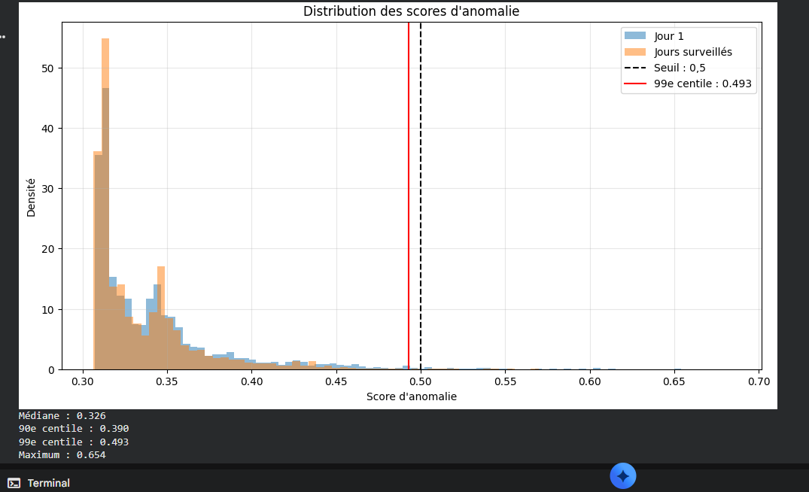
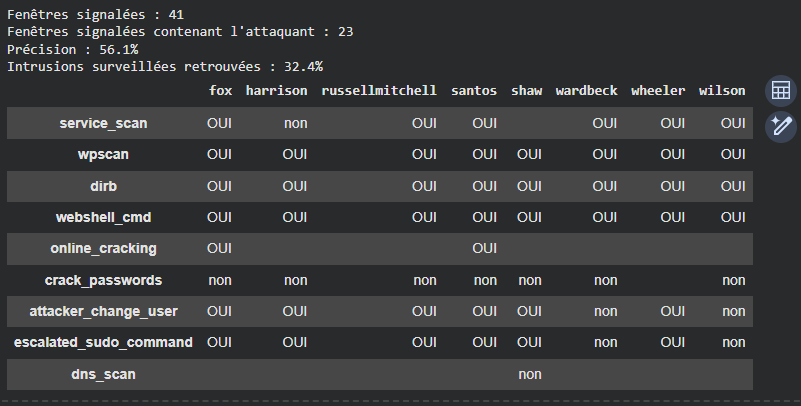
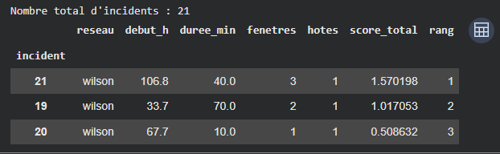

# Détection d'anomalies SOC avec Isolation Forest

Réduction du bruit d'alertes et détection de fenêtres d'activité suspectes sur un
jeu de données SOC multi-réseaux, avec **Isolation Forest** (scikit-learn),
en Python avec pandas et NumPy.

> **Cadre du projet.** Travail académique réalisé à l'**EMSI**, dans le module
> *Intelligence Artificielle pour la Cybersécurité*. Les alertes utilisées
> proviennent d'un jeu de données public déjà produit par Wazuh, Suricata et
> AMiner — ces outils n'ont pas été déployés ou configurés dans le cadre de ce
> projet ; le travail porte sur l'exploitation et l'analyse des alertes qu'ils
> ont générées.

## Contexte et objectif SOC

Un SOC reçoit en continu un grand volume d'alertes de sécurité, dont la plupart
sont du bruit (mises à jour, erreurs applicatives mineures, faux positifs). Ce
projet explore une approche non supervisée pour **réduire ce bruit et faire
remonter les fenêtres temporelles où l'activité s'écarte le plus du
comportement habituel**, sans dépendre d'un jeu d'étiquettes annoté au
préalable — l'étiquetage du dataset n'est utilisé qu'*après coup*, pour évaluer
la détection.

## Dataset

[**AIT Alert Data Set**](https://github.com/ait-aecid/alert-data-set) — un jeu
de données public combinant, sur **huit réseaux d'entreprise simulés** :

- des alertes générées par trois détecteurs : **Wazuh**, **Suricata** et
  **AMiner** ;
- de l'activité normale, sur plusieurs jours ;
- des étapes d'attaque simulées et documentées (scan de service, `wpscan`,
  `dirb`, exécution de commandes via webshell, craquage de mots de passe,
  changement d'utilisateur, élévation `sudo`, exfiltration DNS, etc.), avec
  leur étiquette d'origine dans le dataset.

**Le dataset complet n'est pas republié dans ce dépôt.** Pour le récupérer :

```bash
git clone https://github.com/ait-aecid/alert-data-set.git
# ou téléchargement direct depuis la page du dépôt officiel
```

Chaque réseau fournit un fichier `<reseau>_alerts.txt` (CSV) : `fox`,
`harrison`, `russellmitchell`, `santos`, `shaw`, `wardbeck`, `wheeler`,
`wilson`.

## Méthode

1. **Chargement et préparation.** Les huit fichiers `*_alerts.txt` sont
   chargés et concaténés (**2 655 821 alertes**, 75 types d'alertes
   distincts), avec identification du détecteur d'origine (Wazuh / Suricata /
   AMiner) à partir du code d'alerte, et calcul du temps écoulé depuis le
   début de chaque réseau.
2. **Fenêtrage.** Construction de fenêtres de **10 minutes**, par réseau et
   par hôte, sous forme d'une matrice de comptage (une colonne par type
   d'alerte) — **19 722 fenêtres** au total.
3. **Transformation.** Application d'une transformation `log1p` aux comptages,
   pour atténuer le poids des types d'alertes très fréquents (dont le
   plus courant, *Wazuh: Web server 400 error code*, représente à lui seul
   59,2 % du volume brut).
4. **Entraînement non supervisé.** Un `IsolationForest` (300 arbres,
   `max_samples=256`) est entraîné **uniquement sur les fenêtres du premier
   jour de chaque réseau** (4 385 fenêtres), considéré comme la période de
   référence « normale ». Les 15 337 fenêtres restantes (jours suivants)
   constituent la période surveillée.
5. **Seuil de détection.** Le seuil est fixé au **99ᵉ centile des scores
   d'anomalie du premier jour** (0,493), plutôt qu'à une valeur arbitraire —
   une fenêtre surveillée est signalée si son score dépasse ce seuil.
6. **Regroupement en incidents.** Les fenêtres signalées, consécutives ou
   proches dans le temps pour un même réseau, sont regroupées en incidents,
   puis classées par nombre d'hôtes concernés et score cumulé.
7. **Explication par chemins d'arbres.** Pour une fenêtre donnée, la
   contribution de chaque type d'alerte à son isolement est estimée à partir
   des chemins de décision parcourus dans les arbres du modèle — ce qui
   permet d'indiquer *quelles alertes* ont le plus pesé dans le signalement
   d'une fenêtre, sans boîte noire.
8. **Évaluation a posteriori.** Les résultats sont comparés aux étapes
   d'attaque étiquetées dans le dataset (présentes dans les métadonnées mais
   non utilisées pour l'entraînement), pour mesurer la pertinence des
   fenêtres signalées.
9. **Étude des hyperparamètres et des limites.** Sensibilité du nombre de
   fenêtres signalées à `max_samples` (ψ) et stabilité du classement des
   scores selon le nombre d'arbres (corrélation de rang entre graines
   aléatoires différentes) ; discussion de la limite méthodologique propre à
   toute baseline non supervisée : le premier jour est supposé « normal »
   sans garantie absolue qu'aucune activité suspecte n'y figure déjà, ce qui
   pourrait en théorie contaminer la référence utilisée pour l'entraînement.

## Résultats

| Indicateur | Valeur |
|---|---|
| Seuil retenu (99ᵉ centile, jour 1) | **0,493** |
| Fenêtres signalées (période surveillée) | **41** |
| … dont contenant au moins une étape d'attaque étiquetée | **23** |
| Précision des fenêtres signalées | **56,1 %** |
| Fenêtres d'intrusion surveillées retrouvées | **32,4 %** |
| Incidents regroupés (8 réseaux) | **21** |

> **Lecture des deux derniers indicateurs.** La *précision* indique que,
> parmi les fenêtres signalées par le modèle, un peu plus d'une sur deux
> correspondait effectivement à une étape d'attaque étiquetée. Le taux de
> **32,4 %** correspond à la **part des fenêtres d'intrusion présentes dans la
> période surveillée qui ont été retrouvées** par la détection — ce n'est
> **pas** un taux d'attaques détectées au sens large : une intrusion peut
   s'étendre sur plusieurs fenêtres, et seule une partie d'entre elles a
   dépassé le seuil.


*01 — Distribution des scores d'anomalie (jour 1 vs période surveillée) et seuil retenu à 0,493, contre un seuil fixe arbitraire de 0,5 à titre de comparaison.*


*02 — Bilan de détection sur l'ensemble des huit réseaux, et présence (OUI/non) de chaque étape d'attaque connue par réseau parmi les fenêtres signalées.*

## Étude de cas — réseau `wilson`

Le réseau `wilson` a été étudié plus en détail. La détection y a identifié
**trois incidents**, classés par pertinence :


*03 — Les trois incidents regroupés sur `wilson`, classés par score cumulé décroissant.*

L'incident le mieux classé (score cumulé le plus élevé, h+106,8 à h+107,5,
hôte `intranet_server`) correspond à l'attaque réellement documentée sur ce
réseau dans le dataset, qui se déroule entre h+107,0 et h+107,8 et touche
sept hôtes (`cloud_share`, `inet-firewall`, `intranet_server`, `mail`,
`monitoring`, `vpn`, `webserver`) à travers une chaîne scan de service →
`wpscan` → `dirb` → exécution via webshell → craquage de mot de passe →
changement d'utilisateur → élévation `sudo`. L'explication par chemins
d'arbres pour la fenêtre la plus suspecte de cet incident met en évidence,
entre autres, une tentative de connexion CMS et de nouveaux types de requêtes
HTTP inhabituelles — cohérent avec la nature de l'attaque documentée.

**Mais cette détection a des limites claires, visibles dans les résultats :**
certaines étapes de l'attaque (comme `crack_passwords`) ne sont **jamais**
repérées parmi les fenêtres signalées sur aucun des huit réseaux, et d'autres
étapes (`service_scan`, `attacker_change_user`, `escalated_sudo_command`,
`dns_scan`) ne sont détectées que sur une partie des réseaux où elles
apparaissent. La méthode fait remonter les fenêtres les plus *statistiquement
atypiques*, pas nécessairement chaque étape individuelle d'une attaque.

## Sensibilité aux hyperparamètres

- **`max_samples` (ψ).** Faire varier ψ (64, 256, 1024, taille complète du
  jeu d'entraînement) change sensiblement le nombre de fenêtres signalées (de
  65 à 49) et surtout leur **précision** (de 4,6 % à ψ=64, jusqu'à 57,1 % à
  ψ=4385) — un échantillonnage trop petit par arbre dégrade nettement la
  qualité de la détection sur ces données.
- **Nombre d'arbres.** La corrélation de rang (Spearman) entre les scores
  obtenus avec deux graines aléatoires différentes progresse de 0,686 (10
  arbres) à 0,982 (300 arbres) : un nombre d'arbres trop faible rend le
  classement des fenêtres les plus suspectes peu reproductible d'un
  entraînement à l'autre.

## Limites

- **Baseline non vérifiée.** Le premier jour de chaque réseau est utilisé
  comme référence « normale » par hypothèse, sans confirmation indépendante
  qu'aucune activité suspecte n'y figure déjà ; une contamination de cette
  baseline réduirait la capacité du modèle à détecter des comportements
  similaires ensuite.
- **Détection partielle.** Comme détaillé ci-dessus, plusieurs étapes
  d'attaque documentées échappent à la détection sur un ou plusieurs
  réseaux ; la méthode ne doit pas être présentée comme exhaustive.
- **Chiffres propres à ce jeu de données et à cette configuration.** Le seuil
  (0,493), la précision (56,1 %) et le taux de fenêtres d'intrusion
  retrouvées (32,4 %) dépendent du dataset AIT, de la taille des fenêtres (10
  minutes), des hyperparamètres choisis et du seuil au 99ᵉ centile. **Ces
  résultats ne constituent pas une garantie de performance sur un
  environnement de production réel.**
- **Un seul jeu de données.** Aucune validation croisée sur un autre jeu de
  données ou un autre contexte réseau n'a été réalisée dans ce projet.
- **Granularité temporelle fixe.** Une fenêtre de 10 minutes peut diluer des
  signaux plus brefs ou, à l'inverse, regrouper plusieurs micro-événements
  distincts dans une seule fenêtre.

## Technologies

- Python
- [pandas](https://pandas.pydata.org/) — chargement, nettoyage, fenêtrage,
  agrégation
- [NumPy](https://numpy.org/) — transformation `log1p`, calculs vectorisés
- [scikit-learn](https://scikit-learn.org/) — `IsolationForest`
- [SciPy](https://scipy.org/) — corrélation de rang (Spearman) pour l'étude
  de stabilité
- [Matplotlib](https://matplotlib.org/) — visualisation des distributions de
  scores
- Google Colab (environnement d'exécution du notebook)

## Reproduire ce projet

1. Récupérer le dataset auprès de la source officielle :
   [github.com/ait-aecid/alert-data-set](https://github.com/ait-aecid/alert-data-set).
2. Placer les huit fichiers `<reseau>_alerts.txt` dans le dossier attendu par
   le notebook (`/content/` sous Google Colab, ou à adapter pour une
   exécution locale).
3. Ouvrir [`notebook/soc_anomaly_detection_isolation_forest.ipynb`](notebook/soc_anomaly_detection_isolation_forest.ipynb)
   et exécuter les cellules dans l'ordre.
4. Dépendances : `pandas`, `numpy`, `scikit-learn`, `scipy`, `matplotlib`
   (déjà présentes dans l'environnement Google Colab par défaut).

## Compétences mobilisées

- Préparation et nettoyage de données tabulaires volumineuses avec pandas
  (plus de 2,6 millions de lignes).
- Construction de caractéristiques temporelles (fenêtrage, agrégation par
  réseau et par hôte).
- Détection d'anomalies non supervisée avec `IsolationForest`.
- Choix et justification d'un seuil de détection à partir d'une distribution
  de scores, plutôt qu'une valeur arbitraire.
- Explicabilité d'un modèle d'ensemble par analyse des chemins de décision.
- Évaluation rigoureuse d'une méthode non supervisée face à des étiquettes
  disponibles a posteriori, et analyse de sensibilité aux hyperparamètres.
- Esprit critique sur les limites d'une méthode de détection, présentées de
  façon transparente plutôt que minimisées.

## Portfolio

Ce projet est présenté dans mon portfolio :
[ryad-cyber.github.io](https://ryad-cyber.github.io/#p-soc-anomaly-ml)
